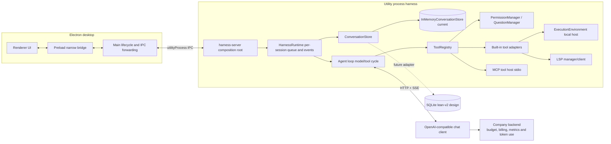
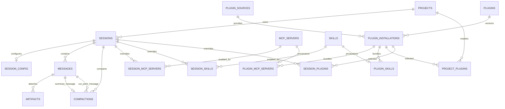

# Architecture overview and desktop database review

This document reflects the current source and reviews `/Users/tienminh/Downloads/ccodex-db-v0.2/lean-v2`. Scope per owner clarification: backend owns metrics, budget, token usage and charges. Desktop owns plugins, MCP, skills, tools, permissions, sessions and session messages. DB schema lives outside this repository and is not modified here.

## Current architecture



### Request path

1. Renderer sends typed commands through preload; `chat.submit` currently carries `sessionId`, prompt, model, optional workspace path and approval mode.
2. Electron main manages windows and the utility process, validating/forwarding commands and events.
3. `harness-server` composes runtime, tools, permission/question managers, MCP/LSP and chat client. Current conversation storage is in-memory.
4. `HarnessRuntime` serializes prompts per session, loads messages, invokes the agent loop and emits events.
5. The agent streams model output, dispatches tools, appends results and continues. Tool adapters use the execution interface and permission preflight.
6. MCP tools are adapted into ToolRegistry. Events return through main/preload to the renderer.

Source map: renderer flow `src/desktop/renderer/pages/WorkspacePage/WorkspacePage.tsx`; bridge `src/desktop/preload/index.ts`; main `src/desktop/main/index.ts`; composition `src/harness-server/index.ts`; runtime `src/harness/runtime.ts`; loop `src/harness/agent/agent-loop.ts`; registry/policy `src/harness/agent/tool-registry.ts`, `src/harness/permissions/permission-manager.ts`; execution `src/harness/execution/`; MCP `src/harness/mcp/`; LSP `src/harness/lsp/`; model API `src/domain/chat/openai-chat-client.ts`; storage seam `src/harness/session/conversation-store.ts`.

SQLite, plugin catalog/installer, login/token lifecycle, and context compaction are not wired. Permission prompts are application checks, not OS isolation; local tools run with host privileges.

## lean-v2 review for desktop-owned data

### Satisfied

- `sessions.project_id` is `TEXT NOT NULL REFERENCES projects(id)`, so every persisted session belongs to one project.
- `session_config` is one-to-one; `messages` owns session conversation history, sequence, state, model metadata, token fields and compaction checkpoints; artifacts link to messages.
- `session_mcp_servers` and `session_skills` store per-session overrides over defaults.
- Secret values are excluded from SQLite; MCP config may store Keychain reference names.
- Ran supplied `python3 verify.py`: 12/12 checks passed (schema/FK integrity, message constraints, artifact direction, compaction, effective MCP override, cascades, startup interruption and concurrent SQLite writers). This verifies schema checks, not app integration. The script regenerated `ccodex.db` and `ccodex-sample.db`, as its README specifies.

### Gaps / changes to consider

1. **Enforce project ownership in application flow.** Current `chat.submit` carries session ID only, which is appropriate if Harness resolves the session in trusted persisted state and gets its `project_id` there. Add a session/project repository when SQLite is integrated; validate selected workspace/session ownership and forward the resolved project ID to the backend. Do not trust a separate renderer-supplied project ID.
2. **Do not add billing tables to desktop DB.** Owner clarified that backend owns budget, metrics, token-use storage and money. Desktop should send the project ID and display backend results; it should not duplicate budget ledgers, token charges or reservation enforcement.
3. **Review `ON DELETE CASCADE` on project → sessions/messages.** It can erase user-visible chat history when a project is removed. Decide whether project removal should soft-delete/restrict and retain sessions, or explicitly purge them. This is a desktop retention choice, not billing retention.
4. **Plugin persistence is only a stub.** `plugins` stores key/version/path/config/default-enabled but lacks catalog/source, immutable installation version/digest, component provenance, and separate install vs enable state.
5. **No `session_plugins`.** Add only if per-session plugin overrides are wanted. Consider project defaults plus session exceptions because project is the workspace grouping; this is a proposal, not a settled preference.
6. **DB/source mismatch:** DB assigns Main ownership of MCP/skills and has session overrides; current runtime reads MCP from `MCP_SERVERS` environment and global skills from `~/.ccodex/skills`. SQLite adapter and integration are absent.
7. **No need for `turns`, `tool_calls`, or `permission_grants` yet** unless UI/query/recovery requirements need independent records. Current `client_request_id` groups a user/assistant pair; `parts_json` stores tool activity; permission requests are runtime state. Avoid normalization tables without a consumer, but add them if analytics, granular replay, durable grants, or queries become requirements.

### Redundant or conditional fields/tables

| DB element | Recommendation under desktop-only ownership | Reason |
|---|---|---|
| `messages.input_tokens`, `output_tokens`, `cache_read_tokens`, `reasoning_tokens` | **Remove from desktop DB** | Backend is the owner of token-use storage/metrics; retaining copies in message rows duplicates authority and can drift. If the UI needs them, fetch/display backend data rather than making SQLite another ledger. |
| `compactions.tokens_before`, `tokens_after` | **Remove unless used for local compaction UX/debugging** | They are token metrics, not required to reconstruct history. Keep only if desktop compaction needs persistent before/after diagnostics; otherwise calculate ephemeral thresholds and leave usage data to backend. |
| `messages.model_provider`, `model_id`, `effort` | **Keep** | These describe how a visible assistant response was generated and support transcript/model switching; they are not usage/billing metrics. |
| `messages.config_snapshot_json` | **Conditional** | Keep only if old turns must be reproducible or inspected under their original settings. Otherwise it duplicates session config; if kept, document its versioned shape and avoid secrets. |
| `turns` | **Defer** | `client_request_id` pairs user and assistant messages and one-running-message constraint covers current execution. Add a turn table only when turn-level UI state/lifecycle cannot be represented cleanly by messages. |
| `tool_calls` | **Defer** | `parts_json` already preserves tool call/result sequence. Normalize only for independent querying, retry/replay, or durable tool lifecycle requirements. |
| `permission_grants` | **Defer** | Current permissions are ask/allow/deny checks with runtime approvals; durable grants need explicit lifetime, scope, revocation and trust requirements first. |
| `session_plugins` | **Add if session override is required** | Existing plugin row has only global default state; project-default + session-exception is a useful model, but should match desired settings UX. |

`project_id` should be immutable after session creation for ordinary UI operations. The current FK/NOT NULL guarantees presence and referential integrity, but not immutability; add an update guard or make reassignment an explicit migration/clone operation. Also reconsider `ON DELETE CASCADE`: it is convenient for hard purge, but project removal otherwise silently removes sessions/messages. `deleted_at` already suggests soft-delete; use that or make deletion an explicit destructive purge flow if chat retention is wanted.

### Recommended desktop schema shape

This is the proposed target for the desktop database, not a claim that the external lean-v2 files or runtime have been migrated. Backend-owned budget, money, metrics, and token usage are deliberately excluded.

**Keep with these decisions:**

- `projects`: retain local project identity/cache (`id`, `name`, `fetched_at`, `last_opened_at`).
- `sessions`: retain `project_id NOT NULL`; treat it as immutable after creation. Use soft deletion for normal UI removal; reserve cascading hard purge for an explicit destructive action.
- `session_config`: keep model selection, effort, permission mode, system prompt, and extra folders. Restrict `permission_mode` to the supported enum in app validation and DB constraint.
- `messages`: keep session, seq, request ID, kind, role, parts, lifecycle state, selected model/provider/effort, errors and timestamps. Remove `input_tokens`, `output_tokens`, `cache_read_tokens`, and `reasoning_tokens`; these belong to backend. Keep `config_snapshot_json` only if historical replay/debug needs it, otherwise remove as duplicate config.
- `artifacts` and `compactions`: keep for message attachments and context reconstruction. Remove `tokens_before`/`tokens_after` from `compactions` unless local compaction diagnostics need them. Preserve summary message and cut-point references.
- `mcp_servers`, `skills`, and default/session overrides: keep, but make ownership/configuration flow consistent between Main/SQLite and current environment/disk-based prototype. Keep secret references only.
- `turns`, `tool_calls`, `permission_grants`: do not add yet. Existing `client_request_id`, `parts_json`, and runtime approval flow suffice until independent queries/replay/durable-grant requirements exist.

**Plugin lifecycle target** (names/columns are proposed; package and activation are separate). `plugins` already exists in lean-v2; the definition below is its replacement shape in a table-rebuild migration, not an additional `CREATE TABLE` to apply unchanged:

```sql
CREATE TABLE plugin_sources (
  id TEXT NOT NULL PRIMARY KEY,
  source_key TEXT NOT NULL UNIQUE,
  source_type TEXT NOT NULL CHECK (source_type IN ('local','git','catalog')),
  locator TEXT NOT NULL,
  trust_state TEXT NOT NULL CHECK (trust_state IN ('trusted','untrusted','blocked')),
  created_at INTEGER NOT NULL,
  updated_at INTEGER NOT NULL
) STRICT;

-- Replacement shape for existing plugins table: stable identity only;
-- one plugin may have several installed versions/sources.
CREATE TABLE plugins (
  id TEXT NOT NULL PRIMARY KEY,
  plugin_key TEXT NOT NULL UNIQUE,
  created_at INTEGER NOT NULL
) STRICT;

CREATE TABLE plugin_installations (
  id TEXT NOT NULL PRIMARY KEY,
  plugin_id TEXT NOT NULL REFERENCES plugins(id) ON DELETE RESTRICT,
  source_id TEXT NOT NULL REFERENCES plugin_sources(id) ON DELETE RESTRICT,
  version TEXT NOT NULL,
  install_path TEXT NOT NULL UNIQUE,
  integrity_sha256 TEXT NOT NULL CHECK (length(integrity_sha256) = 64 AND integrity_sha256 NOT GLOB '*[^0-9a-f]*'),
  manifest_json TEXT NOT NULL CHECK (json_valid(manifest_json) AND json_type(manifest_json) = 'object'),
  state TEXT NOT NULL CHECK (state IN ('installed','invalid','uninstalled')),
  installed_at INTEGER NOT NULL,
  UNIQUE (plugin_id, version, source_id)
) STRICT;

-- Typed provenance links provide real FKs to existing registries; component keys are package-local.
CREATE TABLE plugin_mcp_servers (
  installation_id TEXT NOT NULL REFERENCES plugin_installations(id) ON DELETE CASCADE,
  component_key TEXT NOT NULL,
  mcp_id TEXT NOT NULL UNIQUE REFERENCES mcp_servers(id) ON DELETE RESTRICT,
  PRIMARY KEY (installation_id, component_key)
) STRICT, WITHOUT ROWID;

CREATE TABLE plugin_skills (
  installation_id TEXT NOT NULL REFERENCES plugin_installations(id) ON DELETE CASCADE,
  component_key TEXT NOT NULL,
  skill_id TEXT NOT NULL UNIQUE REFERENCES skills(id) ON DELETE RESTRICT,
  PRIMARY KEY (installation_id, component_key)
) STRICT, WITHOUT ROWID;

CREATE TABLE project_plugins (
  project_id TEXT NOT NULL REFERENCES projects(id) ON DELETE CASCADE,
  installation_id TEXT NOT NULL REFERENCES plugin_installations(id) ON DELETE RESTRICT,
  enabled INTEGER NOT NULL CHECK (enabled IN (0,1)),
  PRIMARY KEY (project_id, installation_id)
) STRICT, WITHOUT ROWID;

CREATE TABLE session_plugins (
  session_id TEXT NOT NULL REFERENCES sessions(id) ON DELETE CASCADE,
  installation_id TEXT NOT NULL REFERENCES plugin_installations(id) ON DELETE RESTRICT,
  enabled INTEGER NOT NULL CHECK (enabled IN (0,1)),
  PRIMARY KEY (session_id, installation_id)
) STRICT, WITHOUT ROWID;

CREATE TRIGGER sessions_project_immutable
BEFORE UPDATE OF project_id ON sessions
WHEN NEW.project_id IS NOT OLD.project_id
BEGIN SELECT RAISE(ABORT, 'session project_id is immutable'); END;
```

Catalog browsing is separate from installation: `plugin_sources` identifies configured origins, `plugins` is the stable logical identity, `plugin_installations` pins immutable versions/digests, typed joins link package components to MCP/skill registries, and project/session tables store explicit enablement overrides. Effective enablement is session override, then project row, then disabled. Installation does not execute code or enable MCP automatically. This v1 proposal supports declarative Agent Plugin packages (skills + MCP config); it does not execute arbitrary plugin JS. Store credentials in Keychain and reference them from MCP configuration, never store secret values in `manifest_json`.

Before adoption, also align the MCP transport CHECK with app support (stdio + Streamable HTTP; legacy SSE only if explicitly required), add JSON/path validation in app code, and decide whether project deletion should preserve or purge sessions.

### Complete desktop database design: tables and fields

This is the proposed logical design assembled from lean-v2 and the decisions above. “Keep” describes current lean-v2 fields retained; “change” describes target changes. All IDs are text IDs; all timestamps are integer Unix milliseconds unless the application contract chooses another single unit. Backend-only billing/metrics/token usage are intentionally absent.

| Table | Fields in the target design | Purpose / constraints |
|---|---|---|
| `projects` (keep) | `id TEXT PK`, `name TEXT NOT NULL`, `fetched_at INTEGER NOT NULL`, `last_opened_at INTEGER NULL` | Locally cached project identity and recency. |
| `sessions` (keep + guard) | `id TEXT PK`, `project_id TEXT NOT NULL FK projects(id)`, `directory TEXT NOT NULL`, `title TEXT NOT NULL`, `title_source TEXT NOT NULL ('auto'|'user')`, `last_preview TEXT NULL (<=200)`, `created_at INTEGER NOT NULL`, `updated_at INTEGER NOT NULL (>= created_at)`, `deleted_at INTEGER NULL` | Every session has exactly one project; make `project_id` immutable after insert. Soft-delete for ordinary removal; hard purge is explicit. |
| `session_config` (keep) | `session_id TEXT PK/FK sessions(id)`, `model_provider TEXT NOT NULL`, `model_id TEXT NOT NULL`, `effort TEXT NULL`, `permission_mode TEXT NOT NULL DEFAULT 'ask'`, `system_prompt TEXT NULL`, `extra_folders_json TEXT NOT NULL DEFAULT '[]'`, `updated_at INTEGER NOT NULL` | Current per-session model and execution preferences. Add CHECK for supported permission modes; validate folder paths in app. |
| `messages` (change) | `id TEXT PK`, `session_id TEXT NOT NULL FK sessions(id)`, `seq INTEGER NOT NULL >0`, `client_request_id TEXT NOT NULL`, `kind TEXT NOT NULL ('reply'|'compaction_summary')`, `role TEXT NOT NULL ('user'|'assistant')`, `parts_json TEXT NOT NULL`, `state TEXT NOT NULL ('running'|'completed'|'failed'|'aborted'|'interrupted')`, `model_provider TEXT NULL`, `model_id TEXT NULL`, `effort TEXT NULL`, `config_snapshot_json TEXT NULL (optional)`, `error_code TEXT NULL`, `created_at INTEGER NOT NULL`, `ended_at INTEGER NULL` | Keep unique `(session_id,seq)` and `(session_id,client_request_id,role)`; one running assistant per session; finished messages immutable. Remove all token fields. Retain config snapshot only for historical replay/debug. |
| `artifacts` (keep) | `id TEXT PK`, `message_id TEXT NOT NULL FK messages(id)`, `direction TEXT NOT NULL ('in'|'out')`, `path TEXT NOT NULL`, `name TEXT NOT NULL`, `mime_type TEXT NOT NULL`, `size_bytes INTEGER NOT NULL >=0`, `sha256 TEXT NULL`, `created_at INTEGER NOT NULL` | File metadata linked to user/assistant message; direction must match role; immutable. Content remains in managed file storage. |
| `compactions` (change) | `id TEXT PK`, `session_id TEXT NOT NULL FK sessions(id)`, `summary_message_id TEXT NOT NULL UNIQUE`, `up_to_message_id TEXT NOT NULL`, `up_to_seq INTEGER NOT NULL >0`, `created_at INTEGER NOT NULL` | Preserve summary/cut-point and same-session constraints. Drop `tokens_before`/`tokens_after` unless local diagnostics are explicitly required. |
| `mcp_servers` (keep/refine) | `id TEXT PK`, `name TEXT NOT NULL`, `transport TEXT NOT NULL ('stdio'|'streamable_http')`, `config_json TEXT NOT NULL object`, `secret_refs_json TEXT NOT NULL array DEFAULT '[]'`, `enabled_by_default INTEGER NOT NULL 0|1`, `created_at INTEGER NOT NULL`, `updated_at INTEGER NOT NULL` | Replace ambiguous `http` label with explicit Streamable HTTP; keep legacy `sse` only if required. Store Keychain key references, never secret values. Validate config schema per transport. |
| `skills` (keep/refine) | `id TEXT PK`, `name TEXT NOT NULL`, `path TEXT NOT NULL`, `version TEXT NULL`, `enabled_by_default INTEGER NOT NULL 0|1`, `created_at INTEGER NOT NULL`, `updated_at INTEGER NOT NULL` | Metadata/index for Agent Skills. Validate metadata and path; content is untrusted instructions, not executable code. |
| `session_mcp_servers` (keep) | `session_id TEXT NOT NULL FK sessions(id)`, `mcp_id TEXT NOT NULL FK mcp_servers(id)`, `enabled INTEGER NOT NULL 0|1`, PK `(session_id,mcp_id)` | Explicit session override only; effective value falls back to server default. |
| `session_skills` (keep) | `session_id TEXT NOT NULL FK sessions(id)`, `skill_id TEXT NOT NULL FK skills(id)`, `enabled INTEGER NOT NULL 0|1`, PK `(session_id,skill_id)` | Explicit session override only; effective value falls back to skill default. |
| `plugin_sources` (add) | `id TEXT PK`, `source_key TEXT NOT NULL UNIQUE`, `source_type TEXT NOT NULL ('local'|'git'|'catalog')`, `locator TEXT NOT NULL`, `trust_state TEXT NOT NULL ('trusted'|'untrusted'|'blocked')`, `created_at INTEGER NOT NULL`, `updated_at INTEGER NOT NULL` | Configured origin/catalog; source trust is app policy and must not be inferred from metadata supplied by a package. |
| `plugins` (replace lean-v2 shape) | `id TEXT PK`, `plugin_key TEXT NOT NULL UNIQUE`, `created_at INTEGER NOT NULL` | Stable logical plugin identity, separated from installed versions. Existing table must be rebuilt/migrated; do not create a second table. |
| `plugin_installations` (add) | `id TEXT PK`, `plugin_id TEXT NOT NULL FK plugins(id)`, `source_id TEXT NOT NULL FK plugin_sources(id)`, `version TEXT NOT NULL`, `install_path TEXT NOT NULL UNIQUE`, `integrity_sha256 TEXT NOT NULL`, `manifest_json TEXT NOT NULL object`, `state TEXT NOT NULL ('installed'|'invalid'|'uninstalled')`, `installed_at INTEGER NOT NULL`, UNIQUE `(plugin_id,version,source_id)` | One immutable installed package version with provenance and integrity. Install is distinct from enable. |
| `plugin_mcp_servers` (add) | `installation_id TEXT NOT NULL FK plugin_installations(id)`, `component_key TEXT NOT NULL`, `mcp_id TEXT NOT NULL UNIQUE FK mcp_servers(id)`, PK `(installation_id,component_key)` | Typed provenance join for MCP components bundled by a plugin. |
| `plugin_skills` (add) | `installation_id TEXT NOT NULL FK plugin_installations(id)`, `component_key TEXT NOT NULL`, `skill_id TEXT NOT NULL UNIQUE FK skills(id)`, PK `(installation_id,component_key)` | Typed provenance join for skills bundled by a plugin. |
| `project_plugins` (add) | `project_id TEXT NOT NULL FK projects(id)`, `installation_id TEXT NOT NULL FK plugin_installations(id)`, `enabled INTEGER NOT NULL 0|1`, PK `(project_id,installation_id)` | Project-level default/override for an installed plugin. |
| `session_plugins` (add) | `session_id TEXT NOT NULL FK sessions(id)`, `installation_id TEXT NOT NULL FK plugin_installations(id)`, `enabled INTEGER NOT NULL 0|1`, PK `(session_id,installation_id)` | Optional session exception. Resolution: session row, else project row, else disabled. |

**Not in the target desktop DB:** budgets, charges, token-use ledgers, model price snapshots, `turns`, `tool_calls`, and `permission_grants`. Add the last three only when durable turn state, independently queryable tool execution, or persistent user grants become concrete product requirements. MCP/skill records may be standalone or plugin-provided; typed provenance joins make that source explicit without duplicating component configuration.

### ER diagram



Each session has one required project (`sessions.project_id`); a project can have many sessions. `SESSION_MCP_SERVERS`, `SESSION_SKILLS`, `PROJECT_PLUGINS`, and `SESSION_PLUGINS` are join/override tables. The plugin provenance joins point to existing MCP/skill records rather than copying their configuration. Backend billing and token-usage tables are intentionally outside this ERD.

## Plugin, MCP, skill, tool model

The share conversation asks for a standards explanation and install flow. Portable Agent Plugins v1 packages skills and MCP configuration; a marketplace is a separate catalog/source. Hooks/subagents are host-specific extensions, not automatically portable components.

| Concept | Desktop responsibility | Executes code? |
|---|---|---|
| Built-in tool | App-owned schema, implementation, permission preflight, ToolRegistry entry | Yes, app code |
| MCP server | External provider; discover `tools/list`, call `tools/call`; current source uses stdio | Yes, separate process/service |
| Skill | Reusable instructions and optional references/assets; load lazily as untrusted context | No |
| Plugin package | Versioned declarative bundle (`plugin.json`, `mcp.json`, `skills/`) | No arbitrary JS in v1 (recommendation) |
| Marketplace | Lists packages and sources/versions; does not execute or equal a package | No |

### Recommended lifecycle

```mermaid
sequenceDiagram
 actor User
 participant UI as Plugin UI
 participant Main as Main / PluginManager
 participant Cat as Catalog
 participant Inst as Installer / validator
 participant Cache as Versioned cache + DB
 User->>UI: Browse catalog and inspect source/version
 UI->>Main: list plugins
 Main->>Cat: resolve metadata
 Cat-->>UI: entries
 User->>UI: install selected version
 UI->>Main: install
 Main->>Inst: fetch and validate manifest, paths, integrity
 Inst->>Cache: save immutable package; mark installed, disabled
```

Install and enable are separate. Recommended enable precedence: session override → project preference → user default → disabled. At session start, PluginManager resolves components; SkillManager exposes metadata then lazy-loads content; MCP manager connects and registers namespaced tool IDs in ToolRegistry. Before every call, re-check enablement and PermissionManager policy; an old model-visible schema must not bypass disablement. On uninstall, reject new calls, resolve in-flight calls by explicit policy, unregister tools and stop unused MCP processes. Pin installed versions; updating creates a new immutable version.

Suggested boundaries: `PluginCatalog` lists/resolves sources; `PluginInstaller` validates and caches; `PluginManager` owns install/enable state; `SkillManager` validates/lazy-loads untrusted instructions; `McpManager` manages connections, handshake, tool list, calls, timeouts and shutdown; existing ToolRegistry/PermissionManager remain the only tool execution/policy route. MCP process startup gives host OS privileges; approval is not sandboxing. Never execute plugin JavaScript in Electron/harness for v1. Keep secret values in Keychain, not manifests/SQLite.

Candidate schema concepts, not migration SQL: `plugin_sources`, immutable `plugin_installations` with digest/manifest snapshot, component provenance joins, optional project plugin preferences and `session_plugins` only if session overrides are needed. Avoid cascading plugin uninstall into independently installed MCP/skills. Choose catalog trust/source, global vs project-vendored install, enablement scope, and in-flight disable behavior before migration.

## Context engineering and compaction learning

The share also asks for context-compaction resources. Tool-output pruning removes selected old observations; compaction replaces a history region with a continuation summary. Both are lossy context management; durable memory is separate storage/retrieval. lean-v2 models a completed `compaction_summary` plus immutable completed assistant cut point and reconstructs from latest summary plus later replies; current source has no compaction runtime. Preserve raw history, user requirements/decisions and tool-call/result pairing; measure prompt growth before implementing.

Study order:

1. [Lost in the Middle (TACL 2024)](https://aclanthology.org/2024.tacl-1.9/) — retrieval in long contexts.
2. [MemGPT (2023)](https://arxiv.org/abs/2310.08560) — working context vs external memory.
3. [Agentic Context Engineering (ACE)](https://arxiv.org/abs/2510.04618) — iterative context updates.
4. [AutoCompact (2026)](https://arxiv.org/abs/2610.02163) and [Compact-Bench (2026)](https://arxiv.org/abs/2610.31710) — learned compaction and coding-agent evaluation; preprint results are benchmark/model-specific.
5. [Codex compaction source](https://github.com/openai/codex/blob/main/codex-rs/core/src/compact.rs) and [Anthropic context editing docs](https://platform.claude.com/docs/en/build-with-claude/context-editing) — concrete history replacement and tool-result clearing.

## Standards and learning links

- [Agent Plugins v1 specification](https://agent-plugins.org/specification) · [client implementation guide](https://agent-plugins.org/client-implementers/implement-an-agent-plugins-client)
- [Agent Skills specification](https://agentskills.io/specification)
- [MCP architecture](https://modelcontextprotocol.io/docs/learn/architecture) · [official TypeScript SDK v2](https://ts.sdk.modelcontextprotocol.io/v2/)
- [Codex plugin packaging/marketplace](https://developers.openai.com/plugins/build/plugins)
- [Claude plugins](https://code.claude.com/docs/en/plugins) · [Claude marketplaces](https://code.claude.com/docs/en/plugin-marketplaces)

## Remaining decisions

- DB session/project invariant is present; application resolution is future work with SQLite integration.
- Backend billing/token data is explicitly out of desktop DB scope.
- Decide project/session deletion retention, catalog sources/trust, install scope, project/session enablement, and behavior for in-flight calls on disable before implementation.
