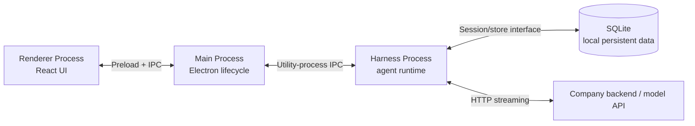

# Coding Agent Harness: domain knowledge và kiến trúc C-CodeX Desktop

### Kết quả học tập

Sau buổi này, người học có thể:

1. Giải thích harness khác model và khác tool như thế nào.
2. Mô tả một agent turn từ prompt đến tool result và câu trả lời cuối.
3. Phân biệt tool, MCP, skill, memory, context và permission.
4. Nêu các kỹ thuật phổ biến để làm agent an toàn, ổn định và tiết kiệm context.
5. Đọc sơ đồ bốn khối của C-CodeX Desktop và biết dữ liệu nên nằm ở đâu.

---

## 1. Domain knowledge: coding agent harness

### 1.1 Bắt đầu từ một câu hỏi

Nếu chỉ có model, người dùng có thể hỏi “test này fail vì sao?” và model trả lời dựa trên đoạn code đã được cung cấp. Nhưng model tự nó không thể mở repository trên máy, chạy test, quan sát output rồi sửa file. Ứng dụng cần một runtime đứng giữa model và môi trường làm việc.

Runtime đó là **harness**.

> **Định nghĩa ngắn:** Harness là phần mềm điều phối model, dữ liệu hội thoại, tool và môi trường thực thi để hoàn thành một nhiệm vụ nhiều bước.

**Ví dụ đời thường:** tưởng tượng mày nhờ một người bạn chuẩn bị bữa tối. Người bạn đọc công thức, xem trong bếp có gì, quyết định làm món nào, dùng dao/bếp để nấu, hỏi mày trước khi dùng nguyên liệu để dành, rồi báo món đã xong. Công thức không tự nấu; người bạn điều phối các bước và dụng cụ. Với coding agent, model giống phần đề xuất cách làm; harness giống người điều phối; tool giống dụng cụ; môi trường thực thi giống căn bếp nơi hành động xảy ra.

Model tạo câu trả lời hoặc đề nghị gọi tool. Harness quyết định gửi thông tin nào cho model, có chấp nhận tool call không, ai thực thi nó, kết quả quay lại hội thoại ra sao, và lượt làm việc kết thúc khi nào.

```text
Model = suy luận và đề xuất bước tiếp theo
Harness = điều phối, kiểm tra, thực thi, giữ trạng thái
Tool = một khả năng cụ thể mà harness cấp cho model
```

### 1.2 Bản đồ các thành phần

| Thành phần | Nói nôm na | Ví dụ trong coding agent |
|---|---|---|
| Model | Người nghĩ ra bước tiếp theo | “Đọc test liên quan trước khi sửa.” |
| Prompt/context builder | Gom giấy tờ cần xem trước khi quyết định | Yêu cầu user, hướng dẫn repo, lịch sử liên quan, kết quả tool |
| Agent loop | Người điều phối quay lại hỏi/nhận thông tin cho tới khi xong việc | Gọi model → nhận `read` → chạy `read` → gửi kết quả → gọi model lại |
| Tool definition | Danh sách dụng cụ và cách yêu cầu dùng chúng | `read(path)`, `bash(command)` |
| Tool registry/dispatcher | Bảng tra xem yêu cầu này giao cho ai | Tìm handler của `read`, kiểm tra input rồi gọi handler |
| Permission/policy | Hỏi chủ nhà trước khi dùng thứ cần xin phép | Cho đọc file trong project; hỏi trước khi sửa file hoặc chạy lệnh |
| Execution environment | Nơi công việc thật sự được làm | Filesystem local, shell, browser, container hay remote worker |
| State/session store | Sổ ghi việc đã làm và việc còn dang dở | Message history và kết quả các bước trước |
| Model provider adapter | Người phiên dịch giữa harness và dịch vụ model | Chuyển request sang API cụ thể rồi đọc response stream |
| Event/transport | Cách báo tiến độ cho người nhờ việc | Text delta, tool started, permission needed, completed |

Không phải harness nào cũng cần một module riêng cho từng hàng. Đây là các **trách nhiệm** cần được xử lý; có thể gộp hoặc tách tùy quy mô và ranh giới bảo mật.

### 1.3 Vòng lặp agent: ví dụ từ đầu đến cuối

Ví dụ đời thường trước: **“Chuẩn bị bữa tối cho bốn người.”** Người điều phối xem yêu cầu và nguyên liệu, nhờ người biết nấu đề xuất món, lấy nguyên liệu bằng dụng cụ phù hợp, hỏi chủ nhà nếu muốn dùng món đồ/đồ ăn cần xin phép, nếm kết quả rồi mới báo xong. Nếu thiếu muối, họ báo thiếu thay vì giả vờ đã nấu đúng công thức.

Giờ ánh xạ sang ví dụ kỹ thuật: user yêu cầu **“Tìm nguyên nhân test `chat-client` fail, sửa lỗi và chạy lại test.”**

```text
1. Harness nhận prompt và xác định session/workspace.
2. Harness dựng context, gửi model cùng danh sách tool khả dụng.
3. Model đề nghị gọi read("tests/chat-client.test.ts").
4. Harness xác thực arguments và áp permission policy.
5. Tool đọc file; kết quả được giới hạn và trả về.
6. Harness thêm tool call + tool result vào hội thoại.
7. Model đề nghị đọc implementation, rồi chạy test.
8. Harness có thể hỏi user trước khi chạy shell command.
9. Tool trả exit code/output; harness gửi kết quả cho model.
10. Model đề nghị sửa file; harness hỏi permission nếu policy yêu cầu.
11. Sau khi sửa và chạy lại test, model tóm tắt nguyên nhân và thay đổi.
12. Harness lưu trạng thái, phát event hoàn tất.
```

Điểm cốt lõi: **model đề nghị hành động; harness mới là bên thực thi hành động**. Model không tự có quyền truy cập file chỉ vì nó có thể viết JSON tên `read`.

Trong ví dụ nấu ăn, model giống người tư vấn món ăn; harness là người điều phối đang đứng trong bếp. Tư vấn có thể nói “hãy dùng dao”, nhưng chỉ người điều phối mới thực sự cầm dao, kiểm tra có được phép dùng nguyên liệu đó không, và làm việc trong căn bếp cụ thể.

### 1.4 Tool call là dữ liệu có cấu trúc

Một tool thường được mô tả bằng tên, mục đích và schema input. Ví dụ giản lược:

```json
{
  "name": "read_file",
  "description": "Read a text file in the selected workspace",
  "parameters": {
    "path": "string",
    "start_line": "integer, optional"
  }
}
```

Model có thể trả về một yêu cầu như:

```json
{
  "tool": "read_file",
  "arguments": {"path": "src/chat-client.ts", "start_line": 1}
}
```

Harness phải kiểm tra tên tool, parse và validate arguments, resolve resource, áp quyền, rồi mới gọi handler. Không nên lấy chuỗi từ model và chạy trực tiếp như shell command mà bỏ qua các bước này.

### 1.5 Tool, MCP, skill và question

| Khái niệm | Nói nôm na | Ví dụ |
|---|---|---|
| Tool | Một dụng cụ làm một việc cụ thể | Dao để cắt; trong agent là đọc file, tìm kiếm, chạy test |
| MCP | Cách cắm thêm một bộ dụng cụ từ bên ngoài theo một chuẩn chung | Kết nối một “quầy thông tin” cung cấp tìm ticket hoặc truy vấn database |
| Skill | Tờ hướng dẫn cách làm một loại việc | Công thức nấu phở; trong agent là quy trình review pull request |
| Question | Dừng lại hỏi người giao việc khi thiếu thông tin | “Mày muốn giữ backward compatibility với API cũ không?” |

MCP không phải loại hành động hoàn toàn khác: sau khi kết nối, MCP tool thường được map thành tool definition mà agent loop có thể gọi. Skill thường là text được đưa vào context; nó không nên tự động được xem như code có quyền thực thi.

### 1.6 Permission và execution boundary

Một pattern phổ biến là tách ba câu hỏi. Trong ví dụ bữa tối: mượn dao gì, có được dùng nguyên liệu để dành không, và việc nấu diễn ra trong căn bếp nào?

1. **Tool yêu cầu gì?** Ví dụ: ghi vào `src/auth.ts`.
2. **Policy quyết định gì?** `allow`, `ask` hay `deny`, xét theo action, resource, workspace và approval mode.
3. **Executor làm việc ở đâu?** Host OS, container, VM hay remote worker.

```text
Tool intent → policy decision → (approval nếu cần) → executor → result
```

Permission prompt và sandbox giải quyết hai việc khác nhau. Prompt làm rõ ý định và xin user đồng ý; sandbox giới hạn mức thiệt hại ngay cả khi tool hoặc model có hành vi ngoài dự kiến. Nếu process chạy với quyền user trên host, việc user bấm “Allow” không biến nó thành process cô lập.

### 1.7 State và các loại trạng thái

- **Turn state:** một lần user gửi yêu cầu và quá trình thực hiện nó.
- **Session state:** lịch sử của cuộc trao đổi qua nhiều turn.
- **Runtime state:** tool call đang chờ, permission đang mở, process MCP đang chạy.
- **Persistent app data:** session, message hoặc cấu hình cần còn sau khi đóng app.
- **External service state:** tài khoản, model catalog, billing và dữ liệu backend.

Không phải mọi trạng thái đều cần lưu cùng cách. Ví dụ permission đang chờ có thể chỉ tồn tại trong memory; transcript thì thường cần persistence; token bí mật nên nằm trong OS secure storage thay vì SQLite.

### 1.8 Các kỹ thuật thường áp dụng khi triển khai

#### Phân lớp theo trách nhiệm

Giữ agent loop không phụ thuộc Electron, React hoặc SQL. Gọi interface như `ChatModel`, `Tool`, `ExecutionEnvironment`, `SessionStore`; cung cấp implementation cụ thể tại composition root. Lợi ích: đổi backend, executor hoặc storage không buộc viết lại vòng lặp agent.

#### Validate ở ranh giới tin cậy

TypeScript types không kiểm tra JSON lúc runtime. Validate command IPC, tool arguments và config từ file/environment bằng schema runtime. Từ chối payload sai hình dạng trước khi nó chạm tới OS hoặc database.

#### Permission theo action và resource

“Cho phép tool này” thường quá rộng. Quy tắc hữu ích hơn xác định action (read/write/execute), resource/path/command, scope, thời hạn và cách thu hồi. Ví dụ: cho phép `git status` trong project này không đồng nghĩa cho phép mọi shell command.

#### Least privilege và executor thay thế được

Chỉ cấp khả năng cần dùng, giới hạn workspace, timeout và output. Để executor sau interface để sau này có thể chuyển từ host sang container/VM/remote worker. Interface thay thế được không tự tạo ra sandbox; enforcement phải nằm ở executor/OS boundary thật.

#### Bounded I/O và timeout

Giới hạn kích thước file, số kết quả tìm kiếm, thời gian chạy process, response download và text đưa lại model. Điều này giảm treo process, chi phí và context phình. Kết quả bị cắt phải báo rõ để model không tưởng rằng đã thấy toàn bộ dữ liệu.

#### Streaming và event lifecycle

Đẩy text delta và sự kiện tool theo thời gian thực thay vì đợi cả turn. Gắn ID ổn định vào request/session/tool call; có trạng thái bắt đầu, thành công, lỗi và hủy để UI không đoán trạng thái.

#### Tuần tự hóa state có xung đột

Hai lượt đồng thời trên cùng một session có thể ghi đè hoặc gửi history thiếu nhất quán. Dùng queue/lock theo session hoặc transaction tương đương; session khác nhau vẫn có thể chạy song song.

#### Lỗi có cấu trúc và trace

Phân biệt model/API error, validation error, permission denied, tool failure, timeout và cancellation. Trace tối thiểu liên kết prompt/turn, model round, tool call, approval và kết quả; che secret và dữ liệu nhạy cảm.

#### Evals và replay

Ngoài unit test cho adapter, xây task mẫu có expected behavior: chọn đúng tool, tôn trọng permission, xử lý lỗi, hoàn tất đúng lúc. Trace có thể phát lại để tái hiện bug mà không cần đoán từ log cuối.

### 1.9 Câu hỏi kiểm tra nhanh cho lớp

- Nếu model trả `bash("rm -rf ...")`, thành phần nào có cơ hội chặn nó?
- Một tool result đã xuất hiện một lần trong transcript có nhất thiết phải gửi lại ở mọi model request không?
- Nếu process riêng bị crash, app có còn quyền đọc file của user không?
- Skill hướng dẫn “bỏ qua permission” có thể thay đổi policy thực thi không?

---

## 2. Context management

### 2.1 Context là gì?

Context là tập hợp thông tin được gửi đến model trong **một request cụ thể**. Nó có thể gồm system/developer instructions, prompt hiện tại, một phần lịch sử, tool definitions, skill instructions và tool results.

Context không đồng nghĩa với toàn bộ dữ liệu đã lưu. Transcript có thể dài; mỗi request nên chỉ mang phần cần thiết để hoàn thành bước hiện tại trong giới hạn model.

**Ví dụ đời thường:** trước khi đi chợ, mày không mang theo toàn bộ đồ đạc trong nhà. Mày lấy một chiếc giỏ vừa đủ và bỏ vào đó danh sách món cần mua, tiền, túi đựng và những ghi chú liên quan. Căn nhà là nơi cất tất cả; chiếc giỏ là context cho chuyến đi này. Tương tự, history/database có thể giữ nhiều thông tin hơn phần model cần xem trong request hiện tại.

```text
Stored history (có thể dài)
        ↓ chọn/lắp
Working context (request này)
        ↓
Model
```

### 2.2 History, context, memory và compaction

| Khái niệm | Vai trò | Ví dụ |
|---|---|---|
| History/transcript | Ghi lại điều đã xảy ra | Prompt, câu trả lời, tool call và kết quả |
| Working context | Phần được gửi cho model lúc này | Prompt hiện tại + hướng dẫn + vài turn liên quan |
| Memory | Facts chọn lọc có thể truy xuất lại | “Repo dùng Bun; không thêm API key tĩnh” |
| Compaction | Rút gọn history cũ thành checkpoint/summary | Summary của đoạn hội thoại cũ + các turn gần đây |
| Retrieval | Tìm memory/tài liệu phù hợp với task rồi đưa vào context | Lấy hướng dẫn build macOS khi user hỏi đóng gói app |

Có thể hình dung: history như quyển sổ ghi mọi việc; memory như vài ghi chú quan trọng được đánh dấu; retrieval là lật đúng trang cần thiết; context là những trang đang đặt trước mặt để giải quyết việc hôm nay.

Memory không phải chỉ là “history lưu lâu hơn”. Cần quyết định lưu facts nào, scope user/project/session, cách tìm, độ tin cậy, cập nhật và xóa.

### 2.3 Vì sao context management quan trọng?

- **Giới hạn cửa sổ:** request vượt context window sẽ lỗi hoặc bị cắt.
- **Chất lượng:** càng nhiều nội dung không liên quan, model càng khó tập trung vào constraint quan trọng.
- **Chi phí và độ trễ:** request dài thường tốn token và thời gian hơn.
- **Tool loop:** kết quả tool lặp lại qua nhiều vòng có thể làm prompt tăng rất nhanh.
- **Tính đúng đắn:** nếu summary bỏ sót quyết định hoặc ghép thiếu tool result, model có thể tiếp tục sai trạng thái.

### 2.4 Ví dụ tăng trưởng context

Giả sử model đọc ba file, mỗi file trả 4.000 token, rồi chạy test trả 2.000 token. Nếu mọi round sau gửi lại toàn bộ tool outputs cùng history, các round tiếp theo lại mang theo phần lớn 14.000 token đó. Context tăng theo số vòng dù user chỉ hỏi một việc.

Kỹ thuật xử lý:

1. Giới hạn output của từng tool và hỗ trợ phân trang.
2. Giữ raw transcript nếu cần audit, nhưng chọn phần hữu ích cho working context.
3. Khi model cần đoạn chưa được giữ, cho phép gọi tool để truy xuất lại.
4. Khi lịch sử vượt budget, compact theo ranh giới an toàn.

### 2.5 Kỹ thuật lắp context

1. **Đo rồi mới tối ưu:** đếm token/ước tính theo đúng tokenizer hoặc API usage; đo system prompt, history, tool schemas và tool outputs riêng.
2. **Dành ngân sách:** giới hạn cho instructions, history, retrieved memory, tools, output và vùng dự phòng.
3. **Giữ thông tin trọng yếu:** yêu cầu user hiện tại, constraints, quyết định đã chốt, trạng thái task, file đã sửa và việc còn dang dở.
4. **Cắt theo cấu trúc:** chỉ loại trọn message/turn phù hợp; không bỏ assistant tool call mà giữ tool result hoặc ngược lại.
5. **Prune trước, compact sau:** tool output cũ và lặp lại thường có thể loại khỏi request; nếu cần tiếp tục qua lịch sử dài, tạo summary checkpoint.
6. **Nạp theo nhu cầu:** skill catalog có thể nhẹ; chỉ tải nội dung skill được chọn. Retrieval cũng chỉ chèn facts liên quan, không nhồi toàn bộ kho memory.
7. **Giữ provenance:** summary/retrieval nên giữ nguồn hoặc message range để biết facts đến từ đâu.
8. **Đánh giá summary bằng task tiếp nối:** đưa summary vào một turn mới và xem agent còn giữ đúng yêu cầu, quyết định, trạng thái và tool-call pairing không.

### 2.6 Compaction bằng ví dụ

```text
Trước:
  messages 1–40, gồm hội thoại và output tool

Sau khi compact:
  instructions
  summary của messages 1–32
  messages 33–40 còn cần thiết
  prompt mới
```

Summary hữu ích trả lời được: mục tiêu là gì, user đã quyết định gì, đã thử gì, kết quả nào đáng tin, file/state hiện ra sao, còn bước nào. Compaction là **lossy**: thông tin bị bỏ không tự quay lại trừ khi transcript gốc còn lưu và hệ thống có thể truy xuất.

### 2.7 Context management trong một coding task

Với yêu cầu “sửa test chat-client”:

- Nạp repo instructions và prompt user.
- Không nạp mọi file repo; dùng search/read để lấy file liên quan.
- Sau khi đọc file, giữ kết luận ngắn và đường dẫn/source liên quan; tránh mang nguyên file dài qua mọi round nếu không cần.
- Giữ chính xác lỗi test và thay đổi user yêu cầu.
- Khi test output dài, giữ failure summary và các dòng liên quan; raw output có thể ở trace.
- Nếu turn kéo dài, summary phải nói rõ file nào đã sửa, test nào đã chạy, trạng thái hiện tại và việc kế tiếp.

### 2.8 Implement context management in harness

```

AgentLoop
   |
   v
ContextManager
   |
   +-- TokenBudgetManager
   |     Calculate remaining context
   |
   +-- ObservationPruner
   |     Prune stale tool outputs
   |
   +-- CompactionPolicy
   |     Decide when to compact
   |
   +-- ContextSummarizer
   |     Generate structured checkpoint
   |
   +-- CheckpointStore
   |     Persist summary and full history
   |
   +-- ContextAssembler
         Build the next model context
   |
   v
LLM Provider
```

---

## 3. Áp dụng vào C-CodeX Desktop: kiến trúc bốn khối

Phần này là **case study của app đang xây**, không phải định nghĩa tổng quát cho mọi harness. App desktop cần UI, nơi điều phối Electron, runtime harness riêng và nơi lưu dữ liệu bền vững.

### 3.1 Sơ đồ bốn khối



Trong sơ đồ, preload/IPC là đường nối. Backend API ở ngoài app local; bốn khối local cần trình bày là Renderer, Main, Harness process và SQLite.

### 3.2 Giải thích từng khối bằng ngôn ngữ người học

#### Renderer Process — “màn hình và tương tác”

React UI hiển thị chat, project, trạng thái tool và hộp thoại xin quyền. Renderer gửi command và nhận event qua API hẹp do preload cung cấp. Nó không nên tự chạy shell, mở database hay giữ secret.

#### Main Process — “người quản lý desktop”

Electron Main tạo cửa sổ, gọi folder picker, khởi chạy/dừng Harness process và nối IPC. Đây là adapter của desktop OS. Nó không nên chứa agent loop hoặc cách model suy luận.

#### Harness Process — “runtime của coding agent”

Process riêng chạy session orchestration, model loop, tool dispatch, permission policy và execution adapter. Tách process giúp công việc agent không nằm trong UI/main event loop và giúp runtime độc lập với React. Tách process **không tự tạo OS sandbox**.

#### SQLite — “sổ tay bền vững của app”

SQLite dự kiến giữ local app data như projects, sessions, messages và cấu hình cần khôi phục. Nó không phải nơi lưu source code của project. Trong thiết kế hiện tại, backend mới là nơi sở hữu billing/metrics/token usage; secret nên nằm trong secure storage của OS.

### 3.3 Demo luồng khi người dùng gửi prompt

```text
1. Người dùng nhập “tìm và sửa test fail” ở Renderer.
2. Renderer gửi command qua preload tới Main.
3. Main kiểm tra và chuyển command sang Harness process.
4. Harness lấy session/history từ storage, dựng context rồi gọi model API.
5. Model yêu cầu đọc file; Harness kiểm tra permission rồi chạy tool.
6. Tool result quay về Harness; Harness gọi model tiếp và phát event tiến độ.
7. Harness lưu message/session vào SQLite (mục tiêu kiến trúc).
8. Event đi ngược qua Main và preload; Renderer cập nhật chat.
```

Command là “hãy làm việc này”; event là “đang xảy ra/đã xảy ra việc này”. Streaming event giúp UI cập nhật trong khi agent còn chạy.

### 3.4 Vì sao Harness process tách khỏi Main?

- **UI responsiveness:** model/tool có thể chạy lâu; không đặt agent loop trong renderer.
- **Rõ trách nhiệm:** Main lo Electron; Harness lo agent.
- **Tái sử dụng:** runtime có thể mở thêm CLI/headless entrypoint mà không mang React theo.
- **Lifecycle và fault boundary:** Harness có thể được khởi động/dừng riêng.

Giới hạn cần dạy rõ: process separation không đồng nghĩa với sandbox. Nếu Harness có quyền user trên host, tool được phép vẫn thao tác được các file/process mà user truy cập.

---

## 4. Lưu folder và SQLite cho app này

### 4.1 Hai nhu cầu khác nhau

Hiện app tạo `~/.ccodex` trong home. Đề xuất là giữ folder này cho nội dung **user-managed**, ví dụ skills người dùng tự cài/thêm. SQLite và app state nên nằm ở app data directory theo OS, không đặt trong repo code hay project workspace.

| Loại dữ liệu | Đề xuất nơi lưu | Ví dụ |
|---|---|---|
| App database | Electron `app.getPath('userData')/ccodex/` | sessions, messages, settings |
| User-managed skills | `~/.ccodex/skills/` | `review/SKILL.md` |
| Project source | Folder người dùng chọn | `/Users/tienminh/code/my-project` |
| Credentials | OS Keychain/Credential Manager/secret service | Refresh/access token reference |
| Cache/log/temp | Thư mục cache/log riêng, có thể dọn | Download hoặc log xoay vòng |

Electron cung cấp `app.getPath('userData')` theo hệ điều hành và app identity; nên tạo subdirectory của app bên trong đó để tránh đụng dữ liệu Chromium. [Electron `app.getPath`](https://www.electronjs.org/docs/latest/api/app#appgetpathname)

Ví dụ minh họa (tên cuối cùng phụ thuộc `productName`/app name thực tế):

```text
macOS:   ~/Library/Application Support/<App Name>/ccodex/ccodex.sqlite
Windows: %APPDATA%/<App Name>/ccodex/ccodex.sqlite
Linux:   ~/.config/<App Name>/ccodex/ccodex.sqlite

Home:    ~/.ccodex/skills/<skill-name>/SKILL.md
Project: /Users/<user>/code/<project>/...  # không copy vào database
```

### 4.2 Folder layout gợi ý

```text
<userData>/
  ccodex/
    ccodex.sqlite
    attachments/        # chỉ khi app cần quản lý file đính kèm lớn
    plugin-cache/       # chỉ khi có plugin installer/cache

~/.ccodex/
  skills/
    <skill-name>/SKILL.md
```

Không cần tạo mọi folder từ đầu. Tạo idempotent khi feature tương ứng cần đến. SQLite có thể dùng WAL nếu phù hợp; khi đó các file journal liên quan phải ở cùng nơi và backup phải theo cách nhất quán, không copy riêng file DB khi đang ghi. [SQLite WAL](https://www.sqlite.org/wal.html)

### 4.3 Chỗ nào giữ kết nối SQLite?

Đây là lựa chọn kiến trúc cần chốt. Hai mô hình phổ biến:

- **Harness sở hữu repository/store**: gần với vai trò Harness đang có; session read/write ở cùng process. Đề xuất ban đầu cho C-CodeX.
- **Main sở hữu DB**: phù hợp nếu Main là owner của mọi app data, nhưng Harness cần giao tiếp qua message protocol mỗi khi đọc/ghi.

Dù chọn cách nào, cần chỉ định một owner rõ ràng, tránh Main và Harness cùng ghi với logic transaction không thống nhất. Agent loop nên gọi interface storage chứ không tự viết SQL.

### 4.4 Những quyết định storage còn cần chốt

- Schema/migration versioning và ownership của từng bảng.
- Project/session xóa mềm hay purge; có giữ transcript khi remove project không.
- Hành vi khi app bị đóng giữa một lượt đang chạy.
- Backup/export, reset app và retention của attachments.
- Secret chỉ lưu trong secure storage; SQLite giữ reference/config không nhạy cảm.

---

## 5. Tóm tắt cuối buổi

```text
Model suy nghĩ và đề xuất.
Harness điều phối một vòng lặp có state.
Tool làm hành động cụ thể.
Permission kiểm soát việc hành động có được phép.
Executor quyết định hành động chạy ở boundary nào.
Context là phần thông tin gửi model ở một request.
Memory/history/storage không phải cùng một khái niệm.
```

Trong C-CodeX Desktop, các khái niệm đó được đặt vào bốn khối: Renderer trình bày và nhận input; Main quản lý Electron; Harness process chạy coding agent; SQLite giữ local state bền vững. Project files ở workspace, skills user-managed ở `~/.ccodex`, database ở app data directory là hướng lưu trữ đề xuất.

### Tài liệu/nguồn đọc thêm

- [Building a Coding Agent from Scratch — course outline](https://github.com/decodingai-magazine/building-a-coding-agent-from-scratch-course#-course-outline)
- [Model Context Protocol — architecture](https://modelcontextprotocol.io/docs/learn/architecture)
- [Electron `app.getPath`](https://www.electronjs.org/docs/latest/api/app#appgetpathname)
- [SQLite Write-Ahead Logging](https://www.sqlite.org/wal.html)
- [OpenCode permissions](https://opencode.ai/docs/permissions/)

